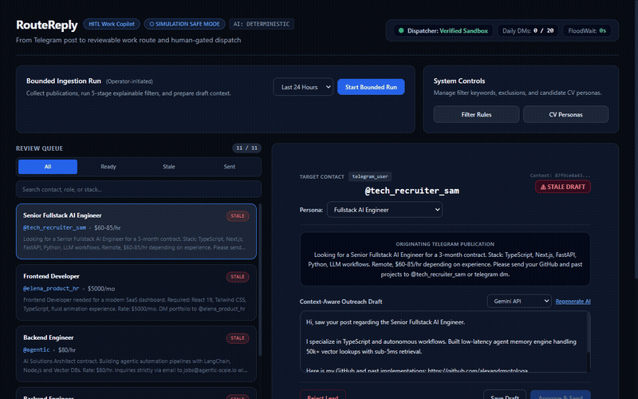
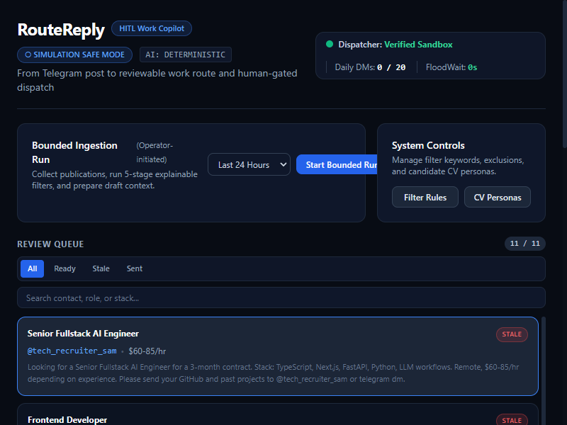
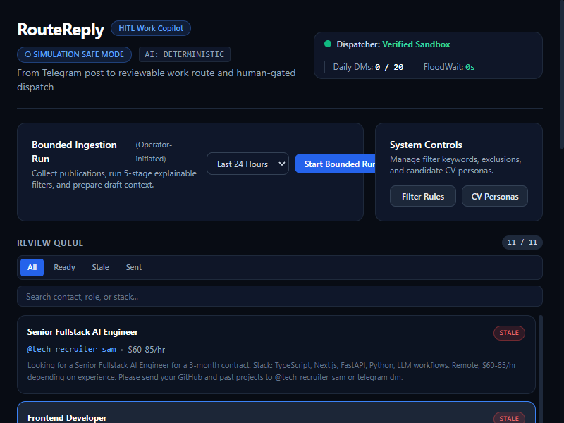
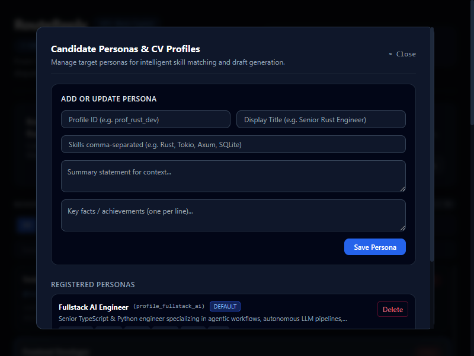
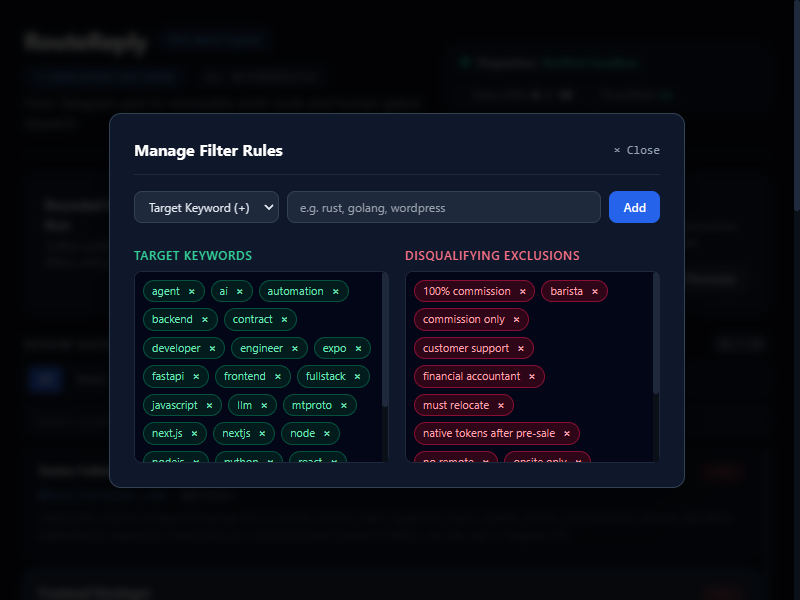

<div align="center">
  
  <h1>RouteReply</h1>
  <p><strong>From Telegram post to reviewable work route and human-gated dispatch.</strong></p>
</div>

<p align="center">
  
</p>

---

## Overview

`RouteReply` is a human-in-the-loop (HITL) work ingestion and outreach copilot for Telegram. It monitors channels and groups, processes publications through an explainable five-stage filter pipeline, matches candidate profiles, and generates context-aware draft responses.

External communication is strictly gated behind an explicit human command. No message is sent automatically, protecting Telegram account reputation, preventing AI spam, and ensuring conversation freshness.

## Invariant Principles

1. **Bounded Runs:** Ingestion operates within explicit time windows and count limits initiated by the operator.
2. **Decoupled Architecture:** The vacancies module owns collection and filtering. The replies module owns draft generation and communication state. Handoff between modules is idempotent.
3. **Strict Human Gate:** Every dispatch requires an operator action. The system verifies delivery only upon receiving a server-confirmed Telegram `message_id`.
4. **Stale Draft Protection:** Reply tasks compute a deterministic SHA-256 context hash over the publication text, candidate profile version, conversation history, and prompt template. When context changes, the draft is marked stale and dispatch is disabled until re-evaluated.
5. **Safe Retry Boundaries:** Uncertain or interrupted external sends are never retried automatically. Rate limits enforce randomized delays (90 to 240 seconds) and daily caps.

---

## Architecture Flow

```
[ Telegram Channels ]
         │
         ▼
[ Bounded Ingestion Run ] (Operator-initiated, non-continuous)
         │
         ▼
[ 5-Stage Filter Funnel ] ── (Discarded with stage reason logged)
  1. Length & Sanitization
  2. Tech Stack & Role Keywords
  3. Negative Exclusions
  4. Contact Resolution (@username, t.me, email, form)
  5. Profile & CV Tag Mapping
         │
         ▼ (Idempotent Handoff)
[ Vacancy Record + Candidate Profile Store ]
         │
         ▼
[ Anti-Slop LLM Draft Generator ] (Direct, proof-first copy under 100 words)
         │
         ▼ (Context Hash Fingerprint)
[ Operator Review Surface / Web Studio ]
         │
  ┌──────┴───────────────────────────┐
  │  Operator Actions:               │
  │  • Inspect Provenance & Filters  │
  │  • Edit Draft / Switch Profile   │
  │  • Explicit: "Approve & Send"    │
  └──────┬───────────────────────────┘
         │
         ▼ (Pre-Flight Freshness Check)
[ MTProto Dispatch Controller ]
         │
         ▼ (Confirmed Server Message ID)
[ Conversation Tracker & Follow-up Queue ]
```

---

## Core Components

- **Storage Engine (`src/core/db.ts`):** Native Node.js SQLite integration (`node:sqlite`) with WAL mode, foreign key enforcement, and typed repositories.
- **Filter Pipeline (`src/vacancies/filters/`):** Sequential five-stage evaluator logging step-by-step audit records to `filter_runs`.
- **Handoff Service (`src/vacancies/handoff.ts`):** Idempotent bridge between vacancies and reply tasks preventing duplicate work items.
- **Context & Freshness Engine (`src/replies/context.ts`, `freshness.ts`):** Context hashing guard detecting profile updates and incoming recruiter messages.
- **Anti-Slop Drafter (`src/replies/drafter.ts`, `validator.ts`):** Deterministic and LLM-compatible generator producing concise, proof-first outreach copy free of robotic AI clichés.
- **Dispatcher & Rate Limiter (`src/dispatcher/`):** Single-controller lock with FloodWait protection and server confirmation recording.
- **Operator Studio (`src/api/`):** Fastify REST API and embedded high-density dark mode dashboard.

---

## Operator Studio Interface

The RouteReply Web Studio provides an interface for inspecting vacancies, reviewing explainable filter audit trails, modifying draft copy, managing candidate personas, and editing dynamic filter rules:

<p align="center">
  
</p>

### Review & Audit Inspection

Inspect five-stage filter evaluation breakdowns, candidate match profiles, and context hash freshness states before triggering human-gated dispatch:

<p align="center">
  
</p>

### Persona & Dynamic Rule Management

Switch between candidate CV personas and configure real-time keyword and exclusion rules directly from the studio:

| Candidate Personas (Multi-CV) | Dynamic Filter Rules |
|:---:|:---:|
|  |  |

---

## Installation

### Prerequisites
- Node.js 22.0.0 or higher
- npm 10.0.0 or higher

```bash
# Clone the repository
git clone https://github.com/alexandrmotologa/routereply.git
cd routereply

# Install dependencies
npm install

# Build TypeScript binaries
npm run build
```

---

## CLI Usage

The `routereply` command-line utility provides complete control over ingestion, review, and dispatch:

```bash
# Seed synthetic test channels, profiles, and publications
node bin/routereply.js seed

# Import real channel exports from Telegram Desktop (result.json)
node bin/routereply.js import-tg ./export_result.json

# Manage dynamic filter rules directly from terminal
node bin/routereply.js rule list
node bin/routereply.js rule add keyword rust
node bin/routereply.js rule add exclusion wordpress

# Execute a bounded ingestion run across active channels
node bin/routereply.js run --hours 24 --max 50

# List pending and drafted items in the operator queue
node bin/routereply.js queue

# Refresh a stale draft after context or profile updates
node bin/routereply.js refresh <taskId>

# Authorize and dispatch a prepared draft to Telegram
node bin/routereply.js dispatch <taskId>

# Launch the Web Studio dashboard and API server
node bin/routereply.js studio --port 3333
```

---

## Configuration (.env)

Copy `.env.example` to `.env` to configure live credentials and AI models:

```bash
# Telegram MTProto (Optional: without these, runs in safe simulation mode)
TELEGRAM_API_ID=
TELEGRAM_API_HASH=
TELEGRAM_SESSION_STRING=
DISPATCH_MODE=simulation   # Set to 'live' for real network sends

# AI Provider: 'gemini', 'ollama', or 'deterministic'
LLM_PROVIDER=gemini
GEMINI_API_KEY=
GEMINI_MODEL=gemini-2.5-flash

# Local Ollama
OLLAMA_HOST=http://localhost:11434
OLLAMA_MODEL=qwen2.5-coder:latest
```

---

## REST API Reference

The embedded Fastify server exposes endpoints for dashboard integrations:

| Method | Endpoint | Description |
|---|---|---|
| `GET` | `/api/health` | Health status and live rate-limiter gauges. |
| `GET` | `/api/channels` | List all monitored Telegram channels. |
| `POST` | `/api/runs/execute` | Trigger a bounded ingestion run. |
| `GET` | `/api/filter-runs/:pubId` | View explainable five-stage filter audit for a post. |
| `GET` | `/api/queue` | Retrieve the operator review queue with live freshness checks. |
| `POST` | `/api/tasks/:id/update-draft` | Edit draft copy or switch matched candidate profile. |
| `POST` | `/api/tasks/:id/regenerate` | Regenerate draft with Gemini, Ollama, or deterministic engine. |
| `POST` | `/api/tasks/:id/reject` | Discard work item and cancel draft. |
| `POST` | `/api/tasks/:id/dispatch` | Human-gated command executing MTProto send. |
| `GET` | `/api/rules` | List active keyword and exclusion filter rules. |
| `POST` | `/api/rules/add` | Add a new filter keyword or exclusion rule. |
| `POST` | `/api/rules/remove` | Delete a filter rule. |
| `GET` | `/api/profiles` | List all candidate personas for multi-CV switching. |
| `GET` | `/api/conversations/:contact` | Retrieve synchronized message history for a contact. |

---

## Test Suite

RouteReply includes comprehensive unit, integration, and end-to-end acceptance tests running on Vitest:

```bash
# Run all tests
npm test

# Run tests in watch mode
npm run test:watch
```

Test coverage includes:
- Multi-stage explainable filter pipeline rules and threshold validations.
- Idempotent handoff and duplicate prevention.
- Context hash calculation and stale draft detection triggers.
- Single-controller lock, FloodWait barriers, and verified dispatch confirmation.
- Full end-to-end acceptance run using synthetic test datasets.

---

## License

MIT License. Designed and engineered by Alexandr Motologa.
